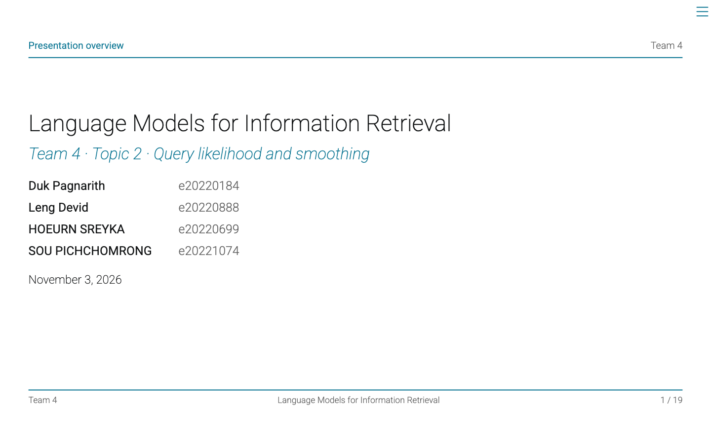

# Language Models for Information Retrieval

This is our Topic 2 group discussion project for Information Web Retrieval and Analytics. It connects query likelihood to the bag-of-words and language model ideas in Lecture 2.

Our main question: if each document has its own language model, which document is most likely to generate a given query?



## Team 4

| Member | Student ID |
|---|---|
| Duk Pagnarith | e20220184 |
| Leng Devid | e20220888 |
| HOEURN SREYKA | e20220699 |
| SOU PICHCHOMRONG | e20221074 |

## Files

- `presentation.qmd`: editable Quarto Reveal.js presentation, with speaker notes and 15 minutes of suggested timing.
- `presentation.css`: content layout, chapter header, and Team 4 footer.
- `presentation-frame.js`: per-slide labels and the four members with student IDs.
- `_extensions/clean/`: the bundled upstream theme and its license.
- `presentation.html`: rendered presentation. Open it in a browser. Press **S** for speaker notes and **F** for full screen.
- `presentation.pdf`: slide submission copy, exported from the same Quarto presentation.
- `language_models_ir.ipynb`: explanation, full Python implementation, executed experiment, results, and defense questions. It also works by itself once the Python packages are installed.
- `data/collection.json`: 15 teaching documents, 5 queries, and declared binary relevance labels.
- `retrieval.py`: reusable implementation matching the notebook.
- `results/`: full rankings, per-query metrics, summary, and smoothing sensitivity.
- `assets/comparison.png`: chart generated by the notebook.
- `speaker-guide.md`: timing, suggested division of speaking parts, and defense practice.

## Run the notebook

Use Python 3.10 or later. We checked the experiment with Python 3.12.

```sh
python -m venv .venv
source .venv/bin/activate
python -m pip install -r requirements.txt
jupyter lab language_models_ir.ipynb
```

Run all notebook cells from top to bottom. No API key or data download is needed after installing the packages. The notebook creates the results and chart in the working directory.

## Presentation theme

The slides use Grant McDermott's [Quarto Reveal.js Clean theme](https://github.com/grantmcdermott/quarto-revealjs-clean), version 1.5.0. The extension is bundled in `_extensions/clean`, so cloning this repository includes the theme. Its MIT license and upstream commit are retained there.

The presentation selects `format: clean-revealjs`. The theme supplies the Roboto typography, white background, blue accents, minimal tables, and navigation styling. `presentation.css` adds content sizing and the top and bottom rules. Each slide shows its chapter above the top rule, with Team 4 and a page number below the bottom rule. `presentation-frame.js` adds these labels and the title-slide roster. Chapter labels are editable through `data-chapter` on each slide heading in `presentation.qmd`. Team names and student IDs are listed in `presentation-frame.js`. Equations use embedded KaTeX instead of the extension's MathJax default. The results chart uses the theme's accent colors.

## Render the presentation

Install [Quarto](https://quarto.org/docs/get-started/), then run:

```sh
quarto render presentation.qmd
```

Open `presentation.html`. Equations use KaTeX. The PDF is the offline submission copy. To export an updated PDF, open the HTML presentation with `?print-pdf` added before any `#` fragment, then use the browser's **Print → Save as PDF**, with landscape orientation, background graphics enabled, and headers/footers disabled.

The slide result table is paired with the checked notebook outputs. If you change data or parameters, rerun the notebook and update the slide result table and discussion. `results/sensitivity-slide.md` is included directly in the Quarto source.

## What our experiment shows

On five handwritten queries, TF-IDF has MAP 0.900 and smoothed query likelihood has MAP 1.000. Both have mean Recall@3 of 0.950. The difference comes from one insurance query. A diagnostic query still retrieves parking instead of insurance, which shows that smoothing does not solve synonym matching.

These are teaching results, not benchmark evidence. We do not claim that query likelihood is generally better than TF-IDF. Labels are our own judgments, parameters are illustrative, and the same queries are used in the sensitivity analysis.

## References

The notebook and final slide contain the full references. Main readings are the supplied Lecture 2, Manning et al. (2008), Ponte and Croft (1998), Zhai and Lafferty (2001), and the Lemur Project's Indri documentation. The supplied course PDFs are not redistributed here.
