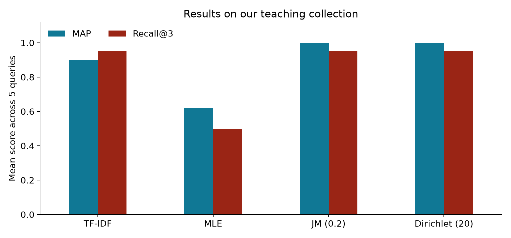

## The search problem

A user types **“language model probability.”**

Our collection contains documents about unigrams, query likelihood, bigrams, and perplexity.

::: {.big-statement}
How can we rank the documents using the probability of the query?
:::

::: {.notes}
Time: 0:55.
A search engine has to decide which documents to show first. Exact word matching gives us useful evidence, but it does not by itself explain how to combine that evidence. Here we ask how likely each document's language model is to generate the words in our query. Our goal is to give relevant documents a higher rank.
:::

## The query likelihood idea

1. Estimate a language model for each document.
2. Calculate how likely that model is to generate the query.
3. Rank documents by that likelihood.

**Input:** a query and a document collection.  
**Output:** documents ordered by score.

::: {.notes}
Time: 0:45.
We can imagine each document as a small source of words. If a document often uses the words in our query, it should usually give that query a higher probability. We use this as a ranking model. We do not ask the model to write an answer, and a high score is not proof that the document satisfies the user.
Source: Manning, Raghavan and Schütze (2008), Chapter 12; Ponte and Croft (1998), https://ciir.cs.umass.edu/pubfiles/ir-120.pdf.
:::

## Connection to Lecture 2

| Lecture 2 | Our retrieval model |
|---|---|
| Bag-of-words | Count terms in each document |
| N-gram probability | Estimate the probability of query text |
| Log probabilities | Add log scores for numerical stability |
| Unseen events and smoothing | Give partial matches a usable score |

**Our choice:** a unigram model, so word order is ignored.

::: {.source}
Course lecture: slides 4–8 and 12–20.
:::

::: {.notes}
Time: 1:00. Background section totals 2:00 across slides 4–5.
Lecture 2 gives us the foundation. A bigram model uses the previous word as context. We use unigrams because short documents and queries give us limited counts. The probability still comes from observed words, but we assume independence instead of modeling word order. Logs preserve ranking and help avoid underflow. They do not solve zero probabilities.
Source: DORN Dawin, Lecture 2: NLP Foundations I: Bag-of-Words and Language Models, October 13, 2026, slides 4–8, 12–20.
:::

## Earlier retrieval methods

| Method | How it matches | Main gap |
|---|---|---|
| Boolean AND | Every required term must appear | Partial matches are rejected |
| TF-IDF cosine | Similarity of weighted term vectors | Depends on exact vocabulary |
| Query likelihood | Probability under each document model | Needs reliable probability estimates |

Ponte and Croft introduced a language modeling approach to IR in **1998**.

::: {.notes}
Time: 1:00.
Boolean AND is useful when we know exactly which terms are required, but it does not give a graded ranking of partial matches. TF-IDF compares weighted term vectors. Query likelihood gives us another scoring principle based on probability estimation. We should not claim that it always outperforms TF-IDF. It also remains a lexical method in this unigram version.
Sources: Ponte and Croft (1998), https://doi.org/10.1145/290941.291008; course Lecture 2, slide 4; Manning et al. (2008), Chapter 12.
:::

## Scoring a document

$$P_{\mathrm{MLE}}(w\mid d)=\frac{c(w,d)}{|d|}$$

$$s(d,q)=\sum_{w\in q}c(w,q)\log P(w\mid d)$$

- $c(w,d)$ counts a word in the document. $|d|$ is its token count.
- Sum over distinct query terms. Repeated terms count again.
- **Higher is better:** a log score of −4 ranks above −8.

::: {.notes}
Time: 0:50. Methodology section totals 4:00 across slides 6–10.
The MLE estimate is a word's relative frequency in a document. Under the unigram assumption, we multiply one probability for every query token. Taking logs gives the sum shown here. Bayes' rule gives P(d given q) proportional to P(q given d) times P(d). We assume equal document priors, which lets us rank by query likelihood. Query likelihood is a model of query generation, not a calibrated probability of user satisfaction.
Source: Lecture 2, slides 13–15; Manning et al., Chapter 12.
:::

## A missing word makes the whole product zero

Query: **“search documents”**

Document: **“language models rank documents”**

$$P_{\mathrm{MLE}}(\text{search}\mid d)=0$$

$$P(q\mid d)=0\times P(\text{documents}\mid d)=0$$

Many partial matches tie at zero. In log space, their score is $-\infty$.

::: {.notes}
Time: 0:40.
This is the same problem as an unseen bigram in Lecture 2. Even though the document contains documents, the missing word search makes the full query probability zero. If many documents miss one query word, we cannot distinguish their partial evidence. Taking a logarithm simply turns zero into negative infinity. We need smoothing before calculating the log.
Source: Lecture 2, slide 18.
:::

## Collection-based smoothing

$$P_\mu(w\mid d)=\frac{c(w,d)+\mu P(w\mid C)}{|d|+\mu}$$

**Dirichlet:** $\mu$ controls collection-based pseudo-counts.

$$P_\lambda(w\mid d)=(1-\lambda)\frac{c(w,d)}{|d|}+\lambda P(w\mid C)$$

**Jelinek–Mercer:** $\lambda$ is a fixed **background weight** here.

::: {.small}
$P(w\mid C)=c(w,C)/|C|$. Collection frequencies replace the uniform background used by add-one smoothing.
:::

::: {.notes}
Time: 1:00.
Dirichlet smoothing adds pseudo-counts based on collection probabilities. The effective background weight is mu divided by document length plus mu. For the same mu, a short document therefore gets more background support. JM uses the same fixed background weight for every document. In this presentation lambda always means background weight. Other sources may reverse that convention. Lecture 2 uses add-one smoothing, which assigns uniform pseudo-counts instead of using collection frequencies.
Source: Zhai and Lafferty (2001), https://www.cs.cmu.edu/~czhai/paper/sigir2001-smooth.pdf. Lecture 2, slide 20.
:::

## A worked calculation

Collection: **14 tokens**, with `search` twice and `documents` three times.

Document C: **“language models rank documents”**, length 4. Set $\mu=5$.

$$P(\text{search}\mid C_{doc})=\frac{0+5(2/14)}{4+5}\approx0.0794$$

$$P(\text{documents}\mid C_{doc})=\frac{1+5(3/14)}{4+5}\approx0.2302$$

$$P(q\mid C_{doc})\approx0.0183,\qquad s\approx-4.003$$

::: {.notes}
Time: 0:50.
This uses a separate three-document example, not the full experiment. Document A is search engines rank documents documents. B is search engines index web pages. C is language models rank documents. Their lengths sum to 14. Search occurs twice in the collection and documents occurs three times. After smoothing, document C receives a small nonzero probability for search. The notebook checks the exact calculation. C_doc means the particular document C, while the background collection probabilities use all three documents.
:::

## Parameters and assumptions

- We use **$\mu=20$** and **$\lambda=0.2$** in the main experiment.
- Larger $\mu$ gives more weight to collection frequencies.
- Unigrams ignore order and do not identify synonyms.
- We report and drop terms absent from the collection.

**All query terms unknown:** return no ranking.

::: {.notes}
Time: 0:40.
The experiment uses very short documents, with an average length of about 16 tokens, so mu 20 is an illustrative setting at that scale. We do not claim it is optimal. We later vary mu to see how the result changes. Collection smoothing cannot give positive probability to a word that is absent from the entire collection. We explicitly report ignored words. For a partly unknown query, we rank using the remaining words.
:::

## Experiment setup

**15 documents · 5 queries · declared binary relevance labels**

| Choice | What we do |
|---|---|
| Preprocessing | Lowercase alphabetic words, no stemming |
| Baseline | TF-IDF cosine similarity |
| Language models | MLE, JM (0.2), Dirichlet (20) |
| Evaluation | P@3, Recall@3, MAP, MRR |

This is a teaching collection with our own labels, not a benchmark.

::: {.notes}
Time: 0:40. Experiment section totals 4:00 across slides 11–15.
Both methods use the same collection and tokenization. We keep stop words and do not stem, so model and models remain different terms. The five queries cover language models, smoothing, crawling, ranking, and car coverage. Labels are declared in the collection before we compare methods. We include all documents in the ranked lists, including zero-score tails, and break exact ties by document ID.
:::

## Python experiment

```python
experiment = RetrievalExperiment(documents)

for query in queries:
    ranking, unknown = experiment.rank(
        query["text"], method="dirichlet", mu=20
    )
    metrics = evaluate(ranking, query["relevant"])
    print(query["id"], ranking[:3], metrics)
```

The notebook includes the full implementation, outputs, and checks.

::: {.notes}
Time: 0:40.
We first count words in each document and in the whole collection. For each query, we estimate a probability for every known query term, add the log probabilities, and sort documents from highest to lowest. The full notebook also runs TF-IDF, MLE and JM. It saves all ranked lists and metrics as CSV files. No API or model download is needed to run the experiment.
:::

## Results on our collection

::: {.columns}
::: {.column width="64%"}
{width=100% fig-alt="MAP and mean Recall at 3 for TF-IDF, MLE, JM and Dirichlet on five teaching queries."}
:::
::: {.column width="36%"}
::: {.small}
| Method | MAP | Recall@3 |
|---|---:|---:|
| TF-IDF | 0.900 | 0.950 |
| MLE | 0.619 | 0.500 |
| JM | 1.000 | 0.950 |
| Dirichlet | 1.000 | 0.950 |

Smoothed models improve the first relevant rank on **one of five queries**.
:::
:::
:::

::: {.notes}
Time: 1:00.
MAP is mean average precision over the full ranked lists. Recall at 3 is the fraction of relevant documents found in the first three results, averaged across queries. Both smoothed models tie TF-IDF on mean Recall at 3. They improve MAP on this example because of the insurance query on the next slide. MLE has many zero-probability ties, so its score depends on our declared document-ID tie order. With five handwritten queries, these results cannot show general superiority or statistical significance. MRR is 0.900 for TF-IDF, 0.815 for MLE, and 1.000 for JM and Dirichlet. Exact values are in results/summary.csv.
:::

## Why Q5 changes rank

Query: **“car coverage”** · Intended need: vehicle insurance

| Method | First result | Second result |
|---|---|---|
| TF-IDF | D14: car parking | D13: automobile insurance |
| Dirichlet | D13: automobile insurance | D14: car parking |

D14 repeats `car`. D13 contains `coverage`, but uses `automobile`.

**What we learned:** smoothing preserves useful partial evidence. It did not learn that `car` and `automobile` are synonyms.

::: {.notes}
Time: 0:50.
D14 discusses a car park and uses car twice. D13 discusses insurance and uses coverage. TF-IDF favors D14, while smoothed query likelihood puts D13 first. We should keep the interpretation narrow. The method combines probabilities in a different way. It has not learned the meaning of automobile. If we change the query to car protection, protection is unknown and dropped, and both methods favor parking. That diagnostic failure is included in the notebook.
:::

## Sensitivity to smoothing



We vary $\mu$ on the same five queries. This is **sensitivity analysis**, not held-out tuning.

For a real study, choose parameters on development queries and report results on separate test queries.

::: {.notes}
Time: 0:50.
The values here come from the executed notebook. We should read the actual table and explain whether the small collection changes under this range. Stable metrics do not mean mu never matters. As mu approaches zero, the estimates approach MLE. As it becomes very large, document models approach the collection model and score differences shrink. We should not select the best value on these five queries and call that an unbiased final test.
Source for smoothing analysis background: Zhai and Lafferty (2001), https://www.cs.cmu.edu/~czhai/paper/sigir2001-smooth.pdf.
:::

## Limitations and comparison

| Limitation | Consequence or next step |
|---|---|
| Exact vocabulary | `car protection` still favors parking |
| Word order ignored | Unigrams cannot distinguish reordered words |
| Parameter choice | Tune smoothing on development queries |
| Tiny, manually judged collection | Use an independent judged benchmark |

TF-IDF is a simple baseline. BM25 adds term-frequency saturation and length normalization, but also relies mainly on lexical matching.

::: {.notes}
Time: 1:00. Limitations and discussion section totals 2:00 across slides 16–17.
The model remains limited by word counts. Bigrams or phrase features could help with order, while query expansion or dense retrieval could help with vocabulary mismatch. Our English tokenizer also needs a different segmentation strategy for Khmer. We have not measured retrieval latency or tested a large collection. Our experiment compares TF-IDF directly. BM25 is a further comparison to add, not a result we have already measured.
:::

## A documented IR system: Indri

The **Lemur Project's Indri** uses language modeling for retrieval.

Its documentation describes query-likelihood scoring with **Dirichlet smoothing** and returned log scores.

Its documented default is **$\mu=2500$**. That setting is not automatically suitable for our short teaching documents.

::: {.source}
[Lemur Project: Indri Document Scoring](https://sourceforge.net/p/lemur/wiki/Indri%20Document%20Scoring/)
:::

::: {.notes}
Time: 1:00.
Indri gives us a concrete system example for the assignment. Its documentation explains why scores are logs and describes Dirichlet smoothing. The documented default is 2500. Our experiment uses much shorter documents and a smaller demonstration value. We should not copy a toolkit default without checking it on the collection. Indri is a documented research retrieval system. We are not claiming that every current commercial search engine uses this model.
Sources: https://sourceforge.net/p/lemur/wiki/Indri%20Document%20Scoring/ and https://www.lemurproject.org/lemur/IndriQueryLanguage.php. Accessed November 3, 2026.
:::

## Conclusion and next steps

::: {.big-statement}
Query likelihood ranks documents by how likely their word distributions are to generate the query.
:::

Smoothing makes partial matches usable. Our experiment shows a benefit on one query and a remaining vocabulary failure.

**Next step:** evaluate on a judged benchmark, tune on development queries, and compare BM25 and query expansion.

::: {.notes}
Time: 1:00. Conclusion and future work section.
What we learned is that the probability estimates matter as much as the scoring formula. The method connects directly to Lecture 2 through counts, independence assumptions, logs, and smoothing. Our small experiment helps us understand the behavior, but a larger evaluation is needed before choosing a model for a real service. Thank you Lokru and everyone. We are ready for your questions.
:::

## References {.small}

- DORN Dawin (2026). *Lecture 2: NLP Foundations I: Bag-of-Words and Language Models*. ITC, slides 4–8, 12–20.
- *Group Discussion Topics: Retrieval Models*. Supplied handout, pp. 1 and 3.
- Manning, Raghavan & Schütze (2008). *Introduction to Information Retrieval*, [Chapter 12](https://nlp.stanford.edu/IR-book/pdf/12lmodel.pdf).
- Ponte & Croft (1998). *A Language Modeling Approach to Information Retrieval*. [SIGIR paper](https://ciir.cs.umass.edu/pubfiles/ir-120.pdf).
- Zhai & Lafferty (2001). *A Study of Smoothing Methods for Language Models Applied to Ad Hoc Information Retrieval*. [SIGIR paper](https://www.cs.cmu.edu/~czhai/paper/sigir2001-smooth.pdf).
- Lemur Project. [Indri scoring](https://sourceforge.net/p/lemur/wiki/Indri%20Document%20Scoring/) and [query language](https://www.lemurproject.org/lemur/IndriQueryLanguage.php).
- Scikit-learn. [TfidfVectorizer API](https://scikit-learn.org/stable/modules/generated/sklearn.feature_extraction.text.TfidfVectorizer.html).

::: {.notes}
References remain visible for discussion. Web documentation accessed November 3, 2026. The Python collection is a handwritten teaching example. All experiment results come from the accompanying notebook, not from the cited papers. Full practice questions and answers are in the notebook and speaker guide.
:::
